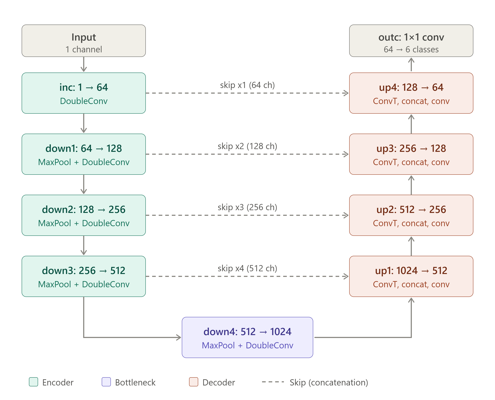
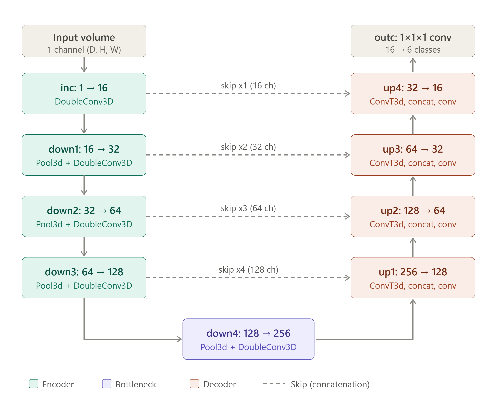
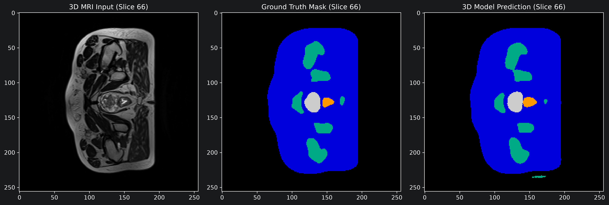
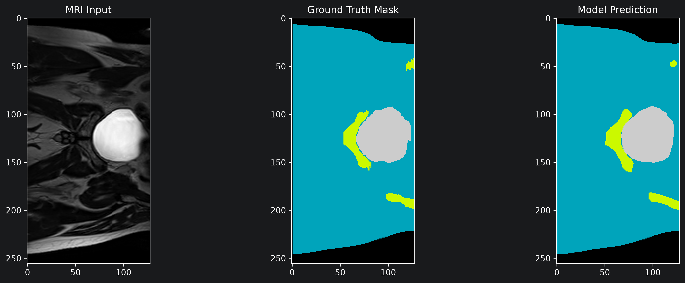
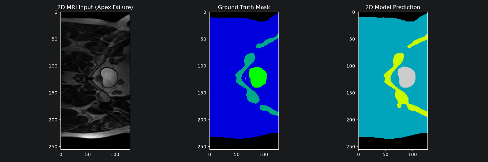
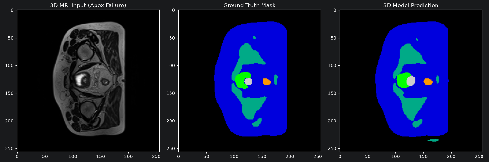
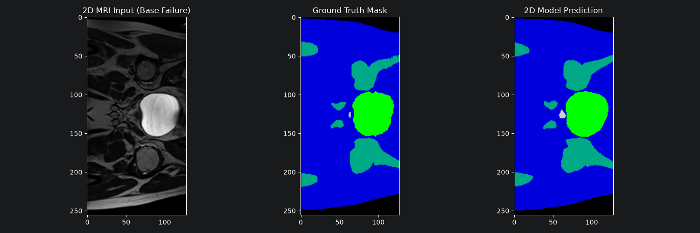
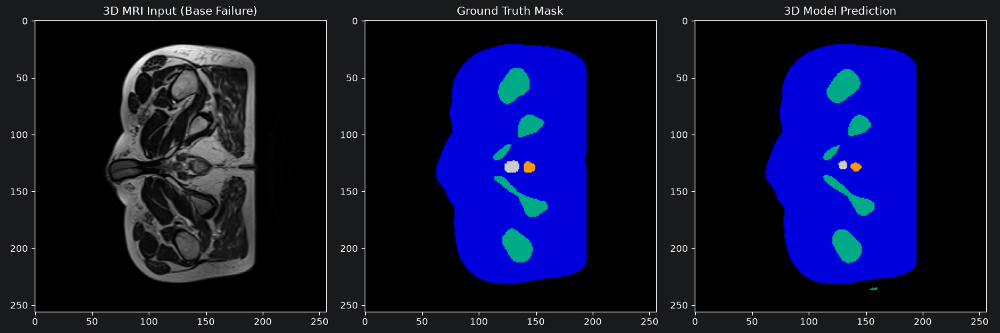

# Prostate Radiotherapy Segmentation: 2D vs 3D - Assessing Benefits of Volumetric Context

Author: Bhaveshyien Thyaganathan - 48426835

## Algorithm and Problem statement
### The problem:
During treatment, the prostate must be specifically targetted, if the beam is over/under contoured there is risk of irradiating patient tissue. Therefore, before treatment, the prostate must be accurately segmented from healthy tissue such that only cancerous tissue is targeted by the radiation beam.

Furthermore, the segmentation capability of 2D models and 3D models will be evaluated in troublesome areas such as the apex and base of the tumour, wherein the tumour may account for less than a percent of total scan area.

### The solution:
This project aims to solve the above problem through the implementation of a 3D UNet architecture to solve a lack of spacial context at the base and apex of the tumour. The ability for the model to discern the tumour will be evaluated
between the 2D and 3D UNets to assess if the additional performance accuracy warrants an increase in compute and resources.

### Algorithm:
The architectures used for both the 2D and 3D models are UNets. These models involve convolving a large context down to a bottleneck where key features are identified, these features are then upscaled and mapped to features from the original through provided skip connections. The 3D network adapts these methods through 3D convolution and 3D max pooling to capture spacial continuity across multiple slices.

### 2D:


### 3D:


<!-- The above 2 representation were generated using Claude -->

## Feasibility Review

### User need, scope and acceptance criteria:

* **Intended User**: An imaging specialist who reviews scans of prostate contours to identify malignant tumours.
* **Purpose**: Test whether 3D volumetric contexts fixes detection at the base and apex of the tumour as opposed to a 2D U-net baseline model.
* **Acceptance criteria**:

| **Criteria**                   | **Descriptor**                                                                            |
|:-------------------------------|:------------------------------------------------------------------------------------------|
| Overall accuracy               | 3D U-net test DICE coefficient ≥ 0.7                                                      |
| Dilemma criterion (boundary)   | Reports DICE separately for the base, mid and apex of each volume.                        |
| Dilemma criterion (continuity) | Quantify consistency within a slice, test for DICE drops between slices                   |
| Resource constraints           | Peak training VRAM ≤ 16Gb, and inference ≤ 10s (per vol.) on a single rangpur GPU (A100). |
| Data Hygiene                   | Zero patient overlap between train/validation/test splits.                                |

### Model choice and course concepts:

* **Data**: Down sampled HipMRI 3D loaded with the Nifti loader in Appendix B. Labels are one-hot encoded, and images are z-score normalised.
* **Model**: 3D U-Net *[Çiçek et al., 2016]*: a 3D encoder–decoder with skip connections, plus instance/batch norm, ReLU, and a Dice + cross-entropy loss to handle the heavy class imbalance.
* **Baseline**: A 2D U-Net *[Ronneberger et al., 2015]* trained on the 2D slices from the same patients, with predictions stacked into volumes and evaluated on the identical test split.
* **Course concepts**: Convolutional feature hierarchies, skip connections, overlap-based losses for imbalanced segmentation, data augmentation, and the memory/compute trade-off of dimensionality.
* **Split**: Patient-level split (e.g. [28 / 5 / 5] patients), because one patient contributes multiple volumes and slice-level splitting would leak anatomy.

### Risks, budget and fallback:

| **Risk**                                     | **Mitigation**                                                               |
|:---------------------------------------------|:-----------------------------------------------------------------------------|
| GPU memory limits at full volume size        | Smaller base filters, batch size 1, mixed precision, or patch-based training |
| Class imbalance (leads to empty predictions) | Dice/Focal loss, patch sampling biased toward the prostate                   |
| Rangpur queue delays                         | Short Slurm jobs with checkpointing; start early                             |

* **Next experiment**: Full 3D vs 2D comparison on the held-out split, with per-region (base/mid/apex) Dice.
* **Fallback**: If full-volume 3D training does not fit in memory or converge, switch to patch-based 3D training. If the 3D model still misses Dice 0.70, report the result honestly with a failure analysis. The dilemma investigation (where context helps and where it doesn’t) still earns marks.

## Dependencies

| **Dependency** | **Version Number** |
|:---------------|:-------------------|
| Python         | 3.14.7             |
| Torch (CuDA)   | 2.14.0+cu126       |
| Numpy          | 2.5.3              |
| Tqdm           | 4.70.1             |
| Nibabel        | 5.4.2              |
| Matplotlib     | 3.11.2             |

## Reproducibility of Results
Seed values were completely randomised between trials, thusly the exact same result can't be reliably reproduced. Furthermore, 3D model was trained on BF16 using torch.amp meaning that reproducibility with that cannot also be guaranteed due to floating point precision.

## Input and output examples

### 3D:


### 2D:


## Preprocessing
3D Nifti volumes were loaded and z-score normalised to standardise intensities. Labels were one-hot encoded for the 6 target classes.

The dataset was split strictly at the patient level (e.g., 168 training volumes, 21 validation volumes, 22 test volumes). This prevents cross-patient data leakage, as splitting by individual slices would cause overlapping anatomy between training and test sets

## Repo structure

### File structure:
```
PatternAnalysis-2026/
├── recognition/
│   ├── UNet_3D_s48426835/
│   │   ├── assets/
│   │   │   └── ...
│   │   ├── training data/ (not included in repo, must be downloaded)
│   │   │   ├── keras_slices_data/
│   │   │   │   └── ...
│   │   │   ├── semantic_labels_only/
│   │   │   │   └── ...
│   │   │   ├── semantic_MRs/
│   │   │   │   └── ...
│   │   │   ├── data_use_agreement.txt
│   │   │   └── ...
│   │   ├── dataset.py
│   │   ├── modules.py
│   │   ├── predict.py
│   │   ├── README.md
│   │   └── train.py
│   └── README.md
├── .gitignore
└── README.md
```

### Files:
* **dataset.py** : contains all the code for loading the HipMRI scan data.
* **modules.py** : contains the model structures for the 2D and 3D UNets
* **predict.py** : contains code that evaluates the models by Dice in addition to rendering the graphs.
* **train.py** : contains code that trains the respective models.

The dataset, ***HipMRI*** is found on the rangpur cluster, it has already been preprocessed by staff for use, it is not supplied in this repo due to file size constraints.

## Investigation of the Open Research Dilemma

### Quantitative benchmarking

| **Metric**  | **Baseline (2D UNet)** | **Proposed (3D UNet)** |
|:------------|:-----------------------|:-----------------------|
| Global Dice | 0.8542                 | 0.8810                 |
| Apex Dice   | 0.0000                 | 0.7424                 |
| Mid Dice    | 0.8571                 | 0.9478                 |
| Base Dice   | 0.3855                 | 0.5697                 |

### Resource profiling
| **Model** | **Parameter Count** | **Peak GPU VRAM**     | **Inference Latency** |
|:----------|:--------------------|:----------------------|:----------------------|
| 2D UNet   | 31,036,806          | 7.3GB (16 batch size) | 1.2 seconds           |
| 3D UNet   | 5,646,470           | 9.1GB (1 batch size)  | 6.5 seconds           |

## Usage Instructions
To replicate the experiments and run the models, ensure your data is located in the paths specified at `./training data/` with the appropriate file structure.

1. **Training the Models:**
   * To train the baseline 2D U-Net, run: `python train.py` (This will execute `train_model()`).
   * To train the proposed 3D U-Net, execute the 3D training routine: `python train.py` (Ensure the `__main__` block call is edited to run `train_model_3d()`).
   * Both models utilise `dataset.py` for data loading and preprocessing, enforcing strict patient-level separation to prevent leakage.
2. **Evaluation and Inference:**
   * Run `python predict.py` to evaluate the saved weights (`unet2d_baseline.pth` and `unet3d_best.pth`). 
   * This script loads the architectures from `modules.py`, processes the test volumes, and outputs the global and per-slice (Base, Mid, Apex) Dice scores, alongside visual predictions which are saved locally.

## Qualitative Error Autopsy
To investigate the spatial context dilemma, 3 boundary failure cases were isolated and analyzed to diagnose edge-case triggers.

***Note on Data Hygiene***: During evaluation, a spatial orientation mismatch was identified between the provided 2D slice dataset and the 3D volumetric dataset. Therefore, rather than a perfectly registered 1:1 slice comparison, the models are compared on their contextual ability to segment the specific anatomical regions (Base and Apex).

### Case 1: The Apex Boundary


* **Diagnosis:** At the inferior apex, the prostate blends into the surrounding pelvic floor muscles with extremely low soft-tissue contrast. 
* **2D vs 3D Performance:** The 2D baseline completely failed to detect the prostate (Dice: 0.0000), treating the faint tissue as background. The 3D U-Net successfully leveraged the volumetric continuity from the mid-gland to maintain a contour (Dice: 0.7424), though it still exhibits minor over-contouring into the surrounding musculature.

### Case 2: The Base Boundary


* **Diagnosis:** At the base of the prostate, the boundary between the prostate and the bladder wall is millimeter-thin. 
* **2D vs 3D Performance:** The 2D model suffered from boundary leakage into the bladder mucosa due to a lack of z-axis context. The 3D model improved the boundary definition (Dice: 0.5697 vs 0.3855), effectively using the spatial gradient of the bladder volume above to terminate the prostate contour, mitigating the risk of radiation cystitis.

### Case 3: Complete misclassification (False Positives)

* **Diagnosis:** The 2D U-Net occasionally completely misclassified regions, for example, the bladder as prostrate. 
* **2D vs 3D Performance:** The 3D U-Net eliminated these topologically invalid scenarios entirely (can't change from a bladder to a prostate within a single slice), as the 3D max-pooling and volumetric kernels enforced spatial continuity, suppressing isolated missmatching classifications between slices.

## Engineering Recommendation
**To the Project Manager:** 
The proposed 3D U-Net resolves the primary clinical boundary dilemma present in the 2D baseline. While the 2D U-Net achieves an acceptable global Dice score (0.8542), it masks catastrophic failures at the apex (0.0000) and base (0.3855), rendering its contours clinically hazardous for radiotherapy planning due to the risk of irradiating the bladder or missing the tumor apex. 

The 3D U-Net rectifies these boundary failures, drastically improving apex detection (0.7424) and eliminating disconnected anatomical hallucinations. This clinical gain comes at a resource trade-off: inference time increases from 1.2s to 6.5s per volume, and the batch size must be restricted to 1 to fit within the 9.1GB VRAM footprint. Given that clinical contouring is not a microsecond-latency task, this computational cost is completely justified. I recommend advancing the 3D U-Net prototype toward clinical translation, as the spatial context is vital for safe external-beam radiotherapy planning.

## Artificial Intelligence Usage Disclosure 
* Claude: Generating model architecture for the readme.md, assisted with .md formatting.